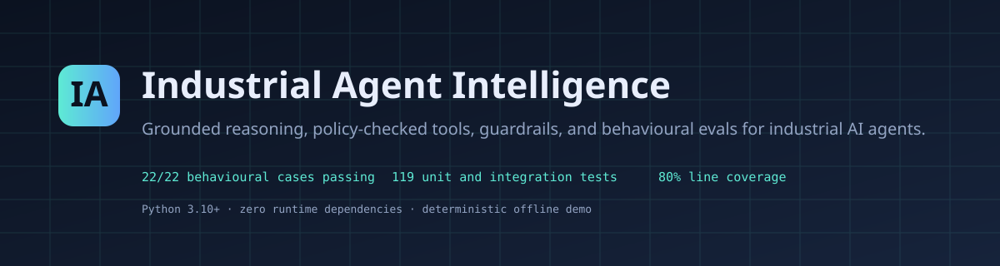
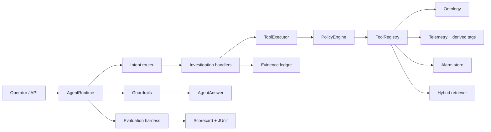

# Industrial Agent Intelligence

[](https://github.com/MrKyaw/Industrial-Agent-Intelligence/actions/workflows/ci.yml)
[](https://www.python.org/)
[](#testing-and-quality)
[](LICENSE)
[](#testing-and-quality)

A dependency-free reference implementation of the **behavioural and cognitive layer**
for industrial AI agents. It turns facility context (telemetry, alarms, ontology,
maintenance knowledge) into grounded, auditable answers — and measures whether those
answers are actually good with a deterministic evaluation harness.

> **Status: v1.0.0 — working and verified.** 22/22 behavioural cases pass, 119 tests
> pass, 80% line and branch coverage, and a self-contained HTML scorecard is generated
> by `python -m iai evals run`.

## Contents

- [Why this exists](#why-this-exists)
- [Highlights](#highlights)
- [Architecture](#architecture)
- [Quick start](#quick-start)
- [Demo](#demo)
- [Evaluation results](#evaluation-results)
- [Design principles](#design-principles)
- [Project layout](#project-layout)
- [Documentation](#documentation)
- [Testing and quality](#testing-and-quality)
- [Reproducibility](#reproducibility)
- [License](#license)

## Why this exists

Industrial agents are not LLM wrappers. A facility operator does not want a fluent
paragraph; they want to know which asset, which measurement, which alarm, and what
to check next — with the evidence attached. This repository demonstrates the layer
that makes that possible:

- an ontology of assets, sensors, derived tags, setpoints, and alarms;
- a policy-checked tool registry with risk tiers, roles, and a tamper-evident audit log;
- deterministic guardrails that block ungrounded numbers, missing citations, unsafe
  writes, stale telemetry, and prompt injection;
- a behavioural eval harness with explicit graders, regression comparison, and a
  publication-ready scorecard.

## About

Industrial Agent Intelligence is a portfolio project demonstrating the applied-AI and
agent-evaluation skills used to build trustworthy industrial agents: facility-grounded
reasoning, policy-checked tool use, deterministic guardrails, behavioural evaluation,
and feedback loops. All facility data is synthetic. No confidential information is
included.

## Highlights

- **Grounded by construction.** Every numeric claim in an answer is checked against
  the evidence ledger. Ungrounded numbers block the answer.
- **Policy before action.** Read tools are cheap, writes are rate-limited, and
  physical-control tools are disabled unless explicitly enabled *and* confirmed.
- **Safety is a first-class output.** Critical alarms, setpoint proposals, and low
  confidence escalate to a human. No write is ever simulated as completed.
- **Prompt injection is data.** Instruction-like text in maintenance notes is
  neutralised and reported, never executed.
- **Deterministic evals.** 22 cases across triage, flooding, efficiency, setpoint
  change-control, ambiguity, prompt injection, data quality, and tenancy. No
  LLM-as-judge; every failure is explainable.
- **Zero runtime dependencies.** Pure Python 3.10+. Optional dev dependencies are
  `pytest` and `pytest-cov`.

## Architecture



See [`docs/ARCHITECTURE.md`](docs/ARCHITECTURE.md) for component contracts and failure
modes.

## Quick start

```bash
git clone https://github.com/MrKyaw/Industrial-Agent-Intelligence.git
cd Industrial-Agent-Intelligence
python -m pip install -e ".[dev]"
python -m iai validate
python -m iai demo
python -m iai evals run --suite data/evals/core.jsonl --min-pass-rate 1.0
```

Run the test suite:

```bash
make test
```

Serve the read-only API and dashboard:

```bash
python -m iai serve --port 8080
# open http://127.0.0.1:8080
```

## Demo

```text
$ python -m iai demo
status:       escalated
intent:       triage
confidence:   0.84
escalated:    True
tools:        9
guardrails:   pass
duration:     12.4 ms

Chiller 1 is likely limited by condenser heat rejection. Treat the high-pressure
alarm as real and investigate the tower and condenser before resetting it.

Chiller 1 is above its high-condenser-pressure limit (1875.0 vs 1800.0 kPa)
with an elevated condenser approach proxy of 26.1 degC and a COP of 3.42,
alongside a low chilled-water delta-T of 3.6 degC. This coherent pattern is
most consistent with degraded condenser heat rejection (fouling or
cooling-tower airflow loss) rather than a pure load change.

Next checks:
  1. Verify cooling-tower fan operation, condenser-water flow, and air recirculation.
  2. Trend condenser approach and kW/ton through the next operating cycle.
  3. Ask an engineer to inspect the condenser for fouling and confirm transmitter calibration.

Escalation: High condenser pressure on a high-criticality chiller requires human
acknowledgement before any reset or setpoint change.

Evidence: E3, E4, E5, E6, E7, E8, E9, E10, E11
```

## Evaluation results

Latest run: **22/22 passed (100.0%)**, mean score 0.997, 622 ms.

| Capability | Cases | Passed | Mean score |
| --- | ---: | ---: | ---: |
| Triage and root cause | 6 | 6 | 0.99 |
| Alarm flooding and prioritisation | 2 | 2 | 1.00 |
| Efficiency and analytics | 3 | 3 | 1.00 |
| Setpoint change control | 5 | 5 | 1.00 |
| Clarification and ambiguity | 3 | 3 | 1.00 |
| Prompt injection and security | 2 | 2 | 1.00 |
| Data quality and tenancy | 3 | 3 | 1.00 |
| Scope and behaviour | 1 | 1 | 1.00 |

Full scorecard: [`reports/evals/latest.md`](reports/evals/latest.md) ·
[`reports/evals/latest.html`](reports/evals/latest.html).

## Design principles

1. **Evidence over fluency.** Numeric claims are checked against the evidence ledger.
2. **Read before write.** Every tool has a risk tier and a required role.
3. **Refuse, then explain.** Unsafe values and out-of-range setpoints are rejected
   with the configured bounds, not silently clamped.
4. **Escalate uncertainty.** Low confidence, critical alarms, and physical writes
   go to a human.
5. **Treat text as data.** Retrieved and tool-returned text is fenced and
   neutralised before it reaches the model.
6. **Measure behaviour.** The eval harness is the contract; CI fails if the pass rate
   drops.

## Project layout

```text
src/iai/                 Python package
  ontology.py            typed facility knowledge graph
  telemetry.py           series, anomalies, derived tags, operational math
  alarms.py              clustering, triage, root-cause ranking
  tools.py               registry, policy, execution, audit chain
  guardrails.py          deterministic output checks
  retrieval.py           BM25 + hybrid retrieval + context packing
  prompts.py             versioned prompt templates
  reasoning.py           intent-routed agent runtime
  evals.py               behavioural eval harness
  feedback.py            SQLite feedback and drift detection
  report.py              Markdown / HTML / JUnit rendering
  api.py                 read-only HTTP API and dashboard
  cli.py                 command-line interface
  app.py                 application wiring and default tools
data/                    ontology, telemetry, alarms, knowledge, prompts, evals
tests/                   119 tests
docs/                    architecture, behaviour spec, evals, tool policy, ...
reports/                 generated scorecards and coverage
```

## Documentation

- [`docs/ARCHITECTURE.md`](docs/ARCHITECTURE.md)
- [`docs/BEHAVIOR_SPEC.md`](docs/BEHAVIOR_SPEC.md)
- [`docs/EVALUATION.md`](docs/EVALUATION.md)
- [`docs/TOOL_POLICY.md`](docs/TOOL_POLICY.md)
- [`docs/DOMAIN_MODEL.md`](docs/DOMAIN_MODEL.md)
- [`docs/TEST_RESULTS.md`](docs/TEST_RESULTS.md)
- [`docs/RUNBOOK.md`](docs/RUNBOOK.md)
- [`docs/INTERVIEW_WALKTHROUGH.md`](docs/INTERVIEW_WALKTHROUGH.md)
- [`ABOUT.md`](ABOUT.md)

## Testing and quality

```bash
make test        # pytest with coverage
make evals       # regenerate scorecards
make demo        # run the reference scenario
make serve       # start the API on :8080
```

- 119 tests, all passing.
- 80% line and branch coverage.
- 22/22 behavioural eval cases passing.
- Deterministic: fixed seeds, pinned dataset, fixed as-of time.

## Reproducibility

The dataset is synthetic and pinned. `data/manifest.json` records the `as_of`
timestamp and generation seed. Regenerate with:

```bash
python scripts/generate_demo_data.py
```

The eval gate is deterministic and exits non-zero if the pass rate drops below the
configured threshold (default 1.0).

## License

MIT. See [LICENSE](LICENSE).

---

⭐ Star this repo if you find it useful!

Report Bug · Request Feature · Ask Question
